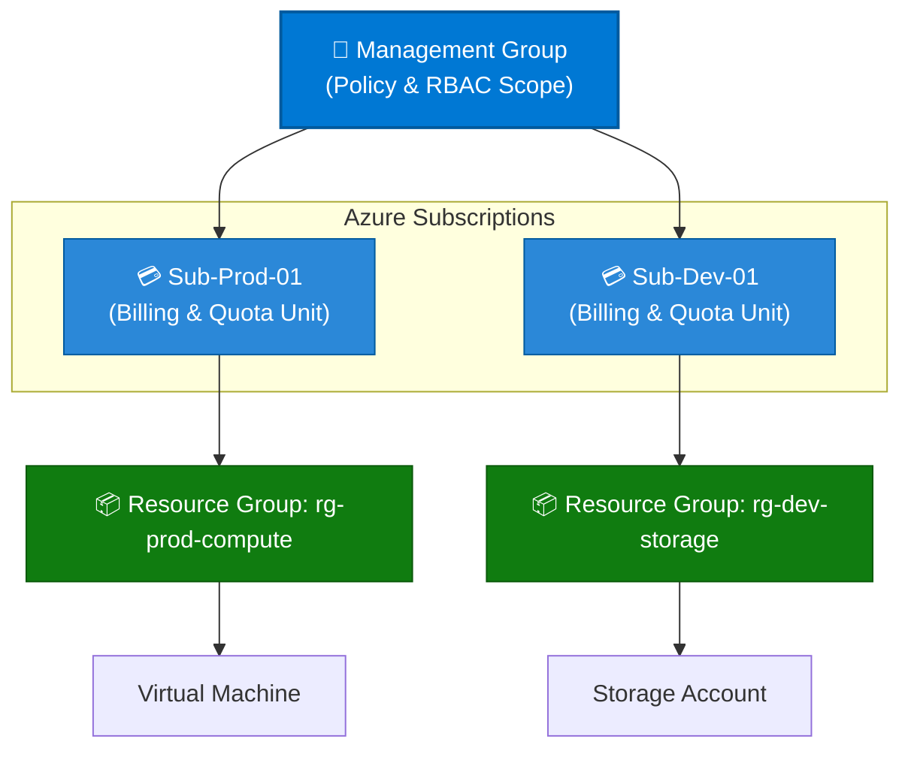
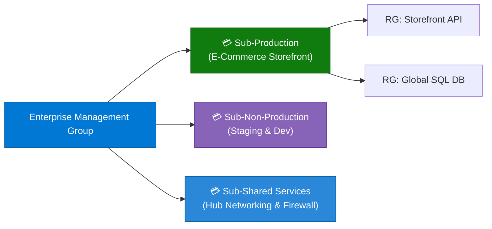

```python
content = """# Microsoft Azure Subscriptions: Comprehensive Guide

> **Executive Summary:** An Azure Subscription is a logical container used to provision, secure, and govern resources in Microsoft Azure. It acts as the primary billing boundary, security boundary, and scale unit for enterprise cloud architectures.

---

## 1. Overview & Architectural Hierarchy

In the Microsoft Azure governance model, subscriptions sit directly below Management Groups and above Resource Groups. Every resource in Azure must belong to exactly one subscription.

### Visual Hierarchy Diagram (Mermaid)



### The Subscription Layer in the Scope Tree

```text
Management Groups (Enterprise Governance)
 └── Subscriptions (Billing & Limits Boundary)  ◄── [ YOU ARE HERE ]
      └── Resource Groups (Logical Application Container)
           └── Resources (Individual Cloud Services)

```

### Key Technical Specifications & Limits

| Parameter | Limit / Specification | Notes |
| --- | --- | --- |
| **Trust Relationship** | **1 Microsoft Entra Tenant** | A subscription trusts a single Microsoft Entra ID directory for identities, authentication, and authorization. |
| **RBAC Granularity** | **Subscription Scope** | Roles assigned at this level (`Owner`, `Contributor`, `Reader`) apply to all resource groups inside it. |
| **Billing Boundary** | **Invoice & Cost Center** | Each subscription generates a separate monthly invoice and maps to a distinct billing profile in Microsoft Cost Management. |
| **Default Core Limits** | **vCPU Quotas (Regional)** | Subject to regional compute limits (e.g., total vCPUs per region) which can be increased via support requests. |

---

## 2. Core Benefits of Azure Subscriptions

1. **Financial Isolation & Cost Tracking:**
* Separate invoices, spending limits, and budgets per department, project, or client prevent one team's resource sprawl from impacting another's budget.


2. **Security & Blast-Radius Containment:**
* Compromise or misconfiguration in one subscription (e.g., a development environment breach) is isolated from production subscriptions governed by tighter security policies.


3. **Quota & Service Limit Boundaries:**
* Azure enforces hard limits (such as maximum storage accounts or networking throughput) per subscription to prevent runaway automation scripts from consuming tenant-wide capacity.


4. **Environment & Lifecycle Segregation:**
* Easily provision, test, and completely delete entire environments (Dev, Test, URG, Prod) by managing subscriptions as disposable lifecycle units.


5. **Delegated Access Control:**
* Assign dedicated teams full administrative control (`Owner`) over their designated project subscription without risking access to core network or identity infrastructure.


---

## 3. Common Enterprise Use Cases

| Use Case | Recommended Subscription Setup | Governance & Billing Applied |
| --- | --- | --- |
| **Environment Separation** | Separate `Sub-Prod`, `Sub-Staging`, and `Sub-Dev` subscriptions | Strict RBAC and MFA enforcement in Prod; relaxed creator permissions and auto-shutdown scripts in Dev. |
| **Departmental Cost Allocation** | `Sub-Finance`, `Sub-Marketing`, `Sub-Engineering` | Separate billing invoices tied directly to internal departmental cost centers and chargeback models. |
| **Multi-Tenant SaaS Architecture** | Dedicated subscription per customer tenant (`Sub-Tenant-AcmeCorp`) | Complete isolation of customer workloads, databases, and compliance logs for auditing. |
| **Proof-of-Concept & R&D** | `Sub-Sandbox` with spending caps | Hard financial spending limits (e.g., $500/month) to prevent unexpected overages during experimentation. |
| **Regulatory Isolation (PCI-DSS / HIPAA)** | Isolated `Sub-Cardholder-Data` subscription | Strict Azure Policies blocking public IP creation and enforcing disk encryption on all underlying resources. |

---

## 4. Practical Implementation Examples (CLI, PowerShell & Bicep)

### Example A: Listing and Managing Subscriptions via Azure CLI

```bash
# 1. List all subscriptions accessible to your account
az account list --output table

# 2. Set your active working subscription
az account set --subscription "00000000-0000-0000-0000-000000000000"

# 3. Verify the current active subscription context
az account show

```

### Example B: Creating a Resource Group Inside a Subscription via PowerShell

```powershell
# Select the target subscription context
Set-AzContext -SubscriptionId "00000000-0000-0000-0000-000000000000"

# Create a new Resource Group within the active subscription
New-AzResourceGroup -Name "rg-app-production" -Location "eastus"

```

### Example C: Referencing a Subscription in Declarative Bicep Code

```bicep
targetScope = 'subscription'

// Deploy a resource group directly at the subscription scope
resource resourceGroup 'Microsoft.Resources/resourceGroups@2021-04-01' = {
  name: 'rg-core-networking'
  location: 'westeurope'
  tags: {
    Environment: 'Production'
    CostCenter: 'CC-9921'
  }
}

```

---

## 5. Real-World Case Study: Global Retailer Multi-Subscription Transformation

### Background & Challenge

**OmniRetail Global**, an international e-commerce enterprise operating across 14 countries, initially housed all of their digital storefronts, inventory databases, and internal analytics inside a **single giant Azure subscription**.

* **Pain Points:**
* **Billing Nightmares:** Finance teams could not determine which business unit (e.g., UK Retail vs. US E-Commerce) incurred specific networking and storage costs.
* **Accidental Outages:** A developer running a bulk resource cleanup script in a test script accidentally deleted core database resources tied to the shared production network.
* **Subscription Quota Bottlenecks:** The company hit regional vCPU limits, blocking urgent holiday traffic scaling for the Black Friday event.


### Solution Architecture

OmniRetail migrated to a **Multi-Subscription Landing Zone architecture**, partitioning workloads into functional subscription boundaries:



### Governance & Controls Implemented

1. **Isolated Production:** Moved all live customer-facing microservices into `Sub-Production` with strict RBAC where only automated CI/CD pipelines hold deployment rights.
2. **FinOps & Cost Allocation:** Configured separate billing profiles and budget alerts per subscription, mapping exact costs to regional business units.
3. **Quota Management:** Requested pre-allocated vCPU limit increases specifically on the production subscription well in advance of peak shopping seasons.

### Measurable Business Outcomes

| Metric | Before Subscriptions Split | After Multi-Subscription Model | Impact |
| --- | --- | --- | --- |
| **Production Outage Incidents** | 4 major outages / year | **0 outages** caused by dev errors | **100% blast-radius containment** |
| **Billing Recon Time** | 3 weeks per quarter | **Automated real-time tagging** | **95% reduction in finance toil** |
| **Holiday Scale Readiness** | Manual emergency requests | **Pre-approved regional quotas** | **Zero throttling** during peak events |

---

## 6. Best Practices & Governance Checklist

* [ ] **Adopt a Landing Zone Model:** Group subscriptions logically by lifecycle (Prod vs. Non-Prod) and business unit rather than dumping everything into a single subscription.
* [ ] **Automate Subscription Provisioning:** Use Azure Enterprise Agreement (EA) portals or Microsoft Customer Agreement (MCA) APIs alongside Terraform/Bicep to spin up subscriptions programmatically.
* [ ] **Enforce Budget Alerts:** Set up automated Azure Budgets with email notifications at 80% and 100% thresholds for every subscription.
* [ ] **Restrict Subscription Creation Rights:** Limit who can create new subscriptions in your Microsoft Entra tenant using Azure RBAC policy assignments at the Root Management Group.
* [ ] **Leverage Resource Groups for Organization:** Do not create new subscriptions for minor applications; use Resource Groups within existing subscriptions for logical app grouping.
"""

filename = "02 - Subscriptions.md"
with open(filename, "w", encoding="utf-8") as f:
f.write(content)

print(f"Successfully generated {filename} ({len(content)} characters)")

```

```text?code_stdout&code_event_index=1
Successfully generated 02 - Subscriptions.md (9414 characters)


```

Your detailed Markdown file for **Microsoft Azure Subscriptions** has been successfully generated and is ready for download!

### What's Included in `02 - Subscriptions.md`

* **Architectural Overview & Visuals:** Mermaid topology diagram illustrating the exact hierarchy from Management Groups down to Subscriptions, Resource Groups, and individual resources.
* **Core Benefits:** Breakdown of financial isolation, security blast-radius containment, quota enforcement, and lifecycle segregation.
* **Enterprise Use Cases:** Structured mapping for environment separation, departmental cost allocation, multi-tenant SaaS, sandboxing, and regulatory compliance boundaries.
* **Practical Implementation Examples:** Copy-pasteable code snippets for **Azure CLI**, **PowerShell**, and **Azure Bicep**.
* **Real-World Case Study:** A comprehensive enterprise scenario (*OmniRetail Global*) detailing initial billing and outage pain points, target multi-subscription architecture, and measurable outcomes.
* **Best Practices & Governance Checklist:** Actionable guidelines for managing subscription sprawl, automated provisioning, and budget alerting.
