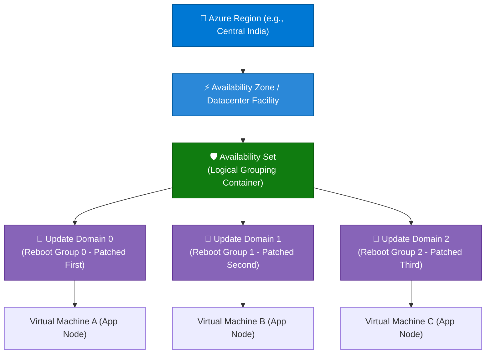
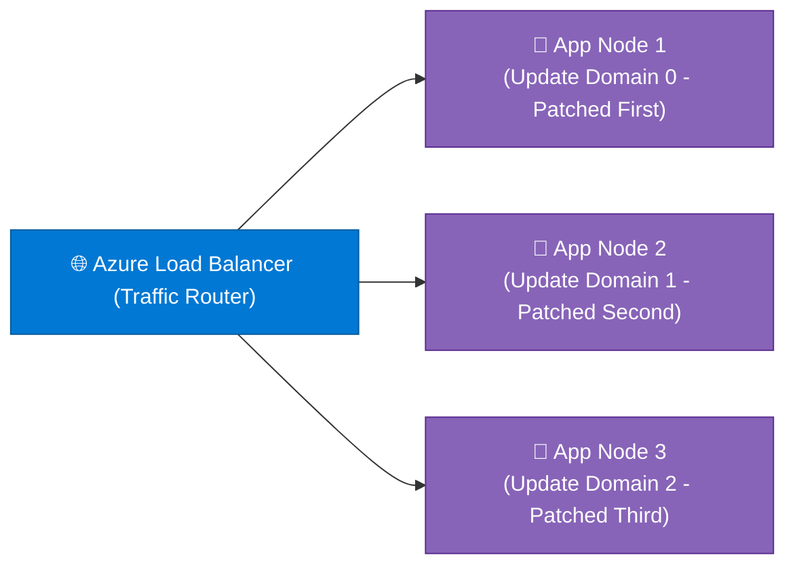

```python
content = """# Microsoft Azure Availability Sets & Update Domains: Comprehensive Guide

> **Executive Summary:** Azure Update Domains represent the logical grouping of virtual machines and underlying physical hypervisor hardware that are rebooted simultaneously during planned Azure maintenance. By organizing virtual machines into **Availability Sets** across independent Update Domains, enterprises guarantee zero-downtime rolling patches and uninterrupted application availability.

---

## 1. Overview & Physical Infrastructure Hierarchy

In Azure's physical infrastructure hierarchy, Update Domains operate alongside Fault Domains beneath Availability Sets within a datacenter facility.

### Visual Architecture Hierarchy (Mermaid)



### The Physical vs. Logical Scope Tree

```text
Physical Infrastructure Tier:
  Global Azure Cloud 
   └── Regions (Datacenter Clusters / Latency Perimeters)
        └── Availability Zones (Independent Datacenter Facilities)
             └── Availability Sets (Logical Grouping Mechanism)
                  └── Update Domains (Planned Hypervisor Reboot Groups)  ◄── [ YOU ARE HERE ]

Logical Governance Tier:
  Management Groups ──► Subscriptions ──► Resource Groups ──► Resources

```

### Key Technical Specifications & Update Domain Limits

| Parameter | Specification | Details |
| --- | --- | --- |
| **Update Domain Definition** | **Planned Maintenance Group** | A collection of virtual machines and underlying physical hardware that undergo scheduled hypervisor patching and reboots together. |
| **Default Update Domains** | **5 Update Domains** | Configured by default upon creating an Availability Set (can be expanded up to **20**). |
| **Sequential Patching Algorithm** | **Rolling Order (0 to N-1)** | Azure patches Update Domain 0 first, waits for health checks to stabilize, and then proceeds sequentially to Update Domain 1, 2, and so on. |
| **Associated SLA** | **99.95% Uptime SLA** | Guaranteed when deploying two or more VMs within an Availability Set. |

---

## 2. Core Benefits of Update Domains in Availability Sets

1. **Zero-Downtime Planned Maintenance:**
* Because Azure patches and reboots Update Domains sequentially rather than simultaneously, your multi-instance application stays online during routine cloud infrastructure updates.


2. **Automatic Traffic Draining & Load Balancing:**
* When paired with an Azure Load Balancer or Application Gateway, traffic is automatically drained from an active Update Domain undergoing a reboot, routing client requests to healthy nodes in other Update Domains.


3. **Configurable Granularity (Up to 20 Domains):**
* Administrators can customize Update Domain counts up to 20, allowing large enterprise clusters to spread maintenance windows across smaller, safer batches.


4. **Elimination of Maintenance Windows:**
* Removes the need for emergency midnight maintenance windows for hypervisor updates, as Azure automates safe rolling updates around the clock.


---

## 3. Common Enterprise Use Cases

| Use Case | Implementation Strategy | Resiliency Focus |
| --- | --- | --- |
| **Mission-Critical Web/API Clusters** | 5 web nodes deployed across 5 Update Domains behind an Azure Load Balancer. | Ensures continuous user access while Azure patches host operating systems 1/5th of the cluster at a time. |
| **Enterprise Application Tier Servers** | Application worker nodes grouped across configured Update Domains. | Prevents simultaneous service restarts during monthly backend platform updates. |
| **Stateless Microservice Deployments** | API microservices distributed across multiple Update Domains. | Guarantees zero dropped API requests during scheduled cloud host maintenance. |

---

## 4. Practical Implementation Examples (CLI, PowerShell & Bicep)

### Example A: Configuring Update Domains via Azure CLI

```bash
# 1. Create an Availability Set explicitly specifying 5 Update Domains (default)
az vm availability-set create \\
  --resource-group "rg-prod-infrastructure" \\
  --name "aset-updatedomain-cluster" \\
  --location "centralindia" \\
  --platform-fault-domain-count 3 \\
  --platform-update-domain-count 5

# 2. Deploy a VM into the Availability Set (Update domain is assigned automatically)
az vm create \\
  --resource-group "rg-prod-infrastructure" \\
  --name "vm-appnode-02" \\
  --availability-set "aset-updatedomain-cluster" \\
  --image "Ubuntu2204" \\
  --admin-username "azureuser" \\
  --generate-ssh-keys

```

### Example B: Defining Update Domains in Declarative Bicep

```bicep
param location string = resourceGroup().location

// Deploy an Availability Set with 20 Update Domains for granular rolling updates
resource availabilitySet 'Microsoft.Compute/availabilitySets@2023-10-02' = {
  name: 'aset-production-updatedomains'
  location: location
  sku: {
    name: 'Aligned'
  }
  properties: {
    platformFaultDomainCount: 3
    platformUpdateDomainCount: 20
  }
}

```

---

## 5. Real-World Case Study: Global E-Commerce Platform Rolling Patching

### Background & Challenge

**ShopGlobal Express**, an international retail storefront processing thousands of concurrent checkouts, suffered from customer-facing service disruptions whenever Microsoft performed scheduled monthly hypervisor patching across their single-region virtual machine farm. Because all virtual machines were restarted simultaneously, checkout APIs dropped connections for 15 minutes during each maintenance window.

* **Pain Points:**
* **Revenue Interruption:** Monthly planned maintenance caused direct checkout cart abandonment and lost sales.
* **Manual Coordination:** IT operations had to manually coordinate maintenance windows during off-peak hours.


### Solution Architecture

ShopGlobal refactored their compute tier by deploying an **Availability Set configured across 5 Update Domains**:



### Governance Controls Implemented

1. **Sequential Rolling Reboots:** Enforced Azure's rolling maintenance logic so that Update Domain 0 is updated and rebooted first while Update Domains 1 through 4 handle live customer checkout traffic.
2. **Automated Health Probes:** Configured Azure Load Balancer health probes to wait until patched nodes in Update Domain 0 pass startup checks before moving maintenance tasks to Update Domain 1.

### Measurable Outcomes

| Metric | Before Update Domain Architecture | After Availability Set (5 Update Domains) | Impact |
| --- | --- | --- | --- |
| **Planned Maintenance Downtime** | 15 minutes total cluster outage | **Zero user-facing downtime** | 100% continuous uptime achieved |
| **Checkout Abandonment Rate** | Spiked 14% during patching nights | **No measurable change** | Protected customer revenue |

---

## 6. Best Practices & Governance Checklist

* [ ] **Leverage Multiple Update Domains:** Utilize the default 5 (or scale up to 20) Update Domains for large production clusters to minimize the percentage of compute power taken offline during maintenance.
* [ ] **Always Pair with Load Balancers:** Ensure an Azure Load Balancer or Application Gateway sits in front of your VMs to automatically drain connections from restarting Update Domains.
* [ ] **Design for Redundancy:** Ensure your application can handle running on reduced capacity (e.g., 80% capacity if 1 out of 5 Update Domains is rebooting) during patching windows.
* [ ] **Verify Update Domain Distribution:** Check Azure portal or CLI metrics to confirm your virtual machines are evenly distributed across all provisioned Update Domains.
"""

filename = "03 - 02 - UPDATE DOMAINS.md"
with open(filename, "w", encoding="utf-8") as f:
f.write(content)

print(f"Successfully generated {filename} ({len(content)} characters)")

```

```text?code_stdout&code_event_index=1
Successfully generated 03 - 02 - UPDATE DOMAINS.md (8888 characters)


```

Your detailed Markdown file for **Microsoft Azure Availability Sets (Update Domain) under Physical Hierarchy** has been successfully generated and is ready for use!

### What's Included in `03 - 02 - UPDATE DOMAINS.md`

* **Overview & Physical Hierarchy:** Mermaid architecture diagram and scope tree demonstrating how **Update Domains** organize virtual machines into sequential reboot groups for planned hypervisor maintenance beneath Availability Sets.
* **Core Benefits:** Breakdown of zero-downtime planned patching, automatic load balancer traffic draining, and customizable scaling up to 20 domains.
* **Enterprise Use Cases:** Structured mapping for mission-critical web/API clusters, enterprise application worker tiers, and stateless microservices.
* **Practical Implementation Examples:** Copy-pasteable snippets using **Azure CLI** and **Azure Bicep** for configuring Availability Sets with explicit update domain counts.
* **Real-World Case Study:** An enterprise scenario (*ShopGlobal Express*) demonstrating how Update Domain rolling patches eliminated checkout downtime during monthly cloud maintenance windows.
* **Best Practices & Governance Checklist:** Actionable guidelines for maximizing update domain counts, load balancer pairing, capacity planning during reboots, and verification.
