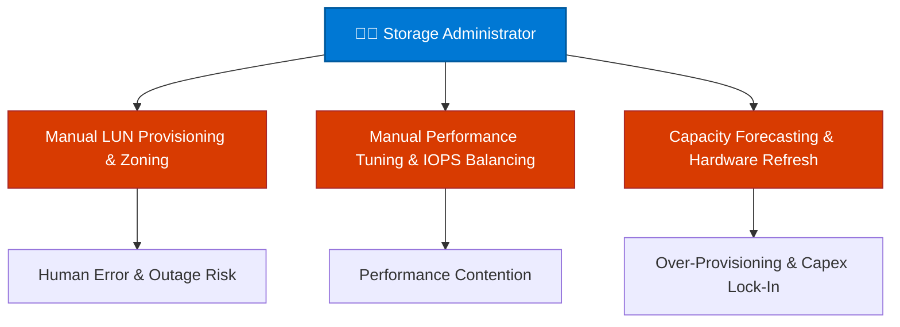

```markdown
# Challenges in Traditional Storage: Complete Enterprise Guide

> **Executive Summary:** Traditional on-premises storage architectures (Storage Area Networks - SAN, Network Attached Storage - NAS, and direct-attached storage arrays) have served enterprise data centers for decades. However, as data scales exponentially, legacy storage models introduce severe operational bottlenecks—spanning heavy management overhead, rigid procurement cycles, complex compliance governance, and manual maintenance toil.

---

## Navigation & Directory Structure

- [01. Management Overhead](#1-management-overhead)
- [02. Procurement & Capital Expenditure (CapEx)](#2-procurement--capital-expenditure-capex)
- [03. Operational Complexity & Maintenance Toil](#3-operational-complexity--maintenance-toil)
- [04. Compliance, Governance & Security](#4-compliance-governance--security)
- [05. Comparative Summary Matrix](#5-comparative-summary-matrix)

---

## 1. Management Overhead

Managing traditional on-premises storage arrays requires specialized human capital, complex fabric switches, and continuous manual intervention.

### Architectural & Operational Bottlenecks



### Key Technical Challenges

* **Specialized Skill Sets Required:** Administrators must master proprietary storage array operating systems, Fibre Channel zoning, multi-pathing software, and specialized RAID controllers.
* **Complex Provisioning Workflows:** Allocating storage requires physical cabling, zoning SAN switches, creating Logical Unit Numbers (LUNs), formatting volumes, and mounting filesystems manually across servers.
* **Human Error Vulnerability:** A single misconfiguration in zoning or multipathing can instantly sever database connectivity for core business applications.

---

## 2. Procurement & Capital Expenditure (CapEx)

Unlike cloud consumption models where capacity scales on demand, traditional storage requires heavy up-front capital expenditure and long-term capacity forecasting.

### Core Procurement Challenges

* **Up-Front Capital Investment:** Organizations must purchase expensive physical disk shelves, SAN controllers, and high-speed Fibre Channel switches years in advance.
* **The Capacity Guessing Game (Over/Under Provisioning):** Capacity planners must forecast storage growth 3 to 5 years ahead. Under-provisioning causes sudden project halts; over-provisioning locks up millions of dollars in idle, depreciating hardware.
* **Rigid Hardware Lifecycles:** Traditional arrays have a physical lifespan of 3 to 5 years, forcing disruptive and expensive data migrations when hardware reaches End-of-Life (EOL).

---

## 3. Operational Complexity & Maintenance Toil

The day-to-day operations of managing physical storage arrays involve grueling maintenance tasks that drain IT engineering bandwidth.

### Major Operational Burdens

* **Firmware & Driver Upgrades:** Applying critical storage controller firmware updates requires coordinating disruptive maintenance windows and careful multi-path driver compatibility checks.
* **Hardware Component Failures:** Hard drives, power supply units (PSUs), and cache batteries fail regularly, requiring physical on-site replacement, disk scrubbing, and RAID rebuild monitoring.
* **Performance Troubleshooting:** Diagnosing noisy neighbor syndromes, queue depth bottlenecks, and latency spikes across shared storage arrays requires deep packet analysis and specialized troubleshooting tools.

---

## 4. Compliance, Governance & Security

Enforcing enterprise data governance and regulatory compliance across isolated on-premises storage arrays is resource-intensive and prone to audit gaps.

### Governance Challenges

* **Siloed Data Protection:** Setting up off-site disaster recovery requires purchasing, cabling, and maintaining identical secondary storage arrays at remote collocation sites.
* **Complex Encryption & Key Management:** Implementing Data-at-Rest Encryption (DARE) requires managing dedicated Hardware Security Modules (HSMs) and manual key rotation policies.
* **Audit Rigidity:** Proving compliance (PCI-DSS, HIPAA, GDPR) requires manual log collection across disparate storage tiers, SAN switches, and backup tapes.

---

## 5. Comparative Summary Matrix

| Traditional Challenge Dimension | On-Premises Traditional Storage | Modern Cloud Storage Alternative (e.g., Azure Storage) |
| --- | --- | --- |
| **Procurement Model** | Heavy Up-Front CapEx (3–5 year forecast) | Pay-as-you-go OpEx (Instant scale) |
| **Management Overhead** | High (Requires dedicated SAN/Storage admins) | Low (Fully managed cloud service / PaaS) |
| **Capacity Expansion** | Slow (Procure, rack, cable, zone new arrays) | Instant (Online expansion with zero downtime) |
| **Maintenance & Patching** | Manual firmware upgrades & hardware swaps | Automated by cloud provider (Zero maintenance toil) |
| **Disaster Recovery** | Expensive secondary hardware buildout | Built-in replication (LRS, ZRS, GRS) |

---

## Related Video Resources

For a deep-dive breakdown of traditional storage challenges compared with modern cloud storage models, watch the video below:

```

```


[](https://youtu.be/y-yhPpZKAYo)
