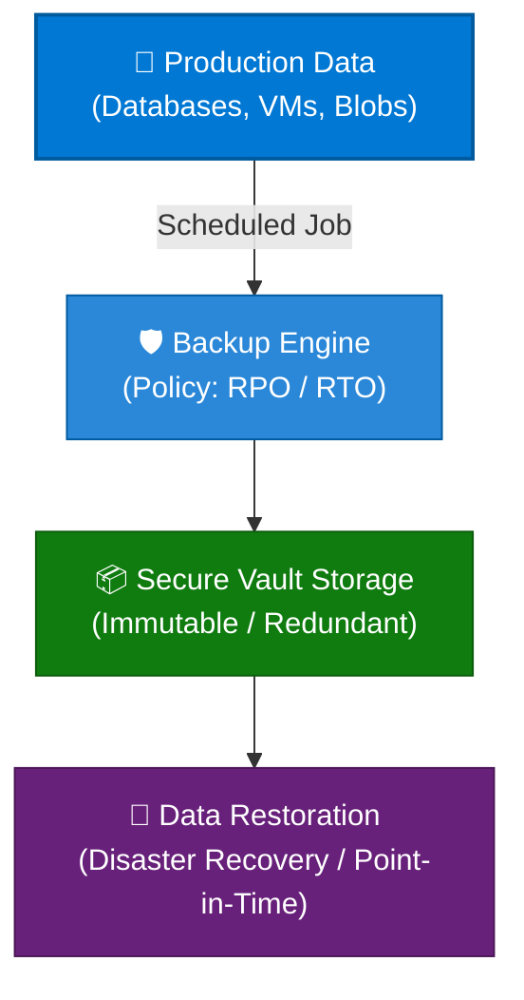

```markdown
# Basics of Backup & Microsoft Azure Backup as a Service (BaaS)

> **Executive Summary:** Data protection is a foundational pillar of enterprise IT governance. This guide covers the core fundamentals of traditional data backup, the shift toward cloud-native Backup as a Service (BaaS), and the architectural advantages of utilizing Microsoft Azure for business continuity and disaster recovery.

---

## Navigation & Directory Structure

- [01. Basics of Backup Fundamentals](#1-basics-of-backup-fundamentals)
- [02. Azure Backup as a Service (BaaS) Advantages](#2-azure-backup-as-a-service-baas-advantages)
- [03. Key Enterprise Use Cases](#3-key-enterprise-use-cases)
- [04. Core Benefits Summary](#4-core-benefits-summary)

---

## 1. Basics of Backup Fundamentals

At its core, a backup is an exact, independent copy of operational data stored separately from the production environment to safeguard against data loss, corruption, or ransomware attacks.

### Core Backup Concepts



* **Recovery Point Objective (RPO):** The maximum acceptable data loss measured in time (e.g., how fresh the backup must be, such as a 24-hour RPO or 1-hour RPO).
* **Recovery Time Objective (RTO):** The duration of time within which a business process or application must be restored after a disruption.
* **Backup Types:**
* **Full Backup:** Copies all selected data (comprehensive but storage-heavy).
* **Incremental Backup:** Copies only data changed since the last backup of any type (fastest, minimal storage).
* **Differential Backup:** Copies data changed since the last *full* backup.


---

## 2. Azure Backup as a Service (BaaS) Advantages

Traditional on-premises backups require managing physical tape libraries, off-site truck transport, and manual script verification. **Azure Backup** transforms this into a fully managed, cloud-native service (BaaS).

### Architectural Comparison

| Feature / Dimension | Legacy On-Premises Backup | Azure Backup as a Service (BaaS) |
| --- | --- | --- |
| **Infrastructure Management** | Manual hardware maintenance, tape rotation, and storage array upkeep. | **Fully Managed PaaS** (Zero hardware maintenance toil). |
| **Scalability** | Rigid capacity limits; requires disruptive hardware refreshes. | **Infinite Elasticity**; instantly scales storage as data grows. |
| **Off-Site Protection** | Expensive secondary data centers and physical tape transport. | **Built-in Geo-Redundant Storage (GRS)** and cross-region replication. |
| **Security & Immutability** | Vulnerable to local ransomware and administrative compromise. | **Vault Immutability, Soft Delete, and Multi-User Authorization (MUA)**. |

---

## 3. Key Enterprise Use Cases

1. **Hybrid & Multi-Cloud Backup Consolidation:**
* Protecting both on-premises workloads (via MARS/MABS agents) and cloud workloads (Azure VMs, Disks, PostgreSQL, and AKS) through a centralized portal.


2. **Ransomware Mitigation & Immutable Recovery:**
* Utilizing immutable vaults and soft delete settings to ensure backup payloads cannot be maliciously purged or encrypted by compromised credentials.


3. **Regulatory Audit Compliance:**
* Meeting long-term data retention mandates (e.g., 7-year yearly retention for financial and healthcare records) with automated tiering and archiving.


---

## 4. Core Benefits Summary

* **Cost-Effective Consumption Model:** Pay strictly for storage consumed and backup instances protected; eliminate capital expenditure (CapEx) on physical backup infrastructure.
* **Application-Consistent Snapshots:** Seamless VSS integration for Windows and fsfreeze for Linux ensure databases remain quiescent and transaction-safe during backups.
* **Automated Retention Management:** Policy-driven lifecycle management automatically transitions recovery points from daily to weekly, monthly, and yearly tiers.

```

```
